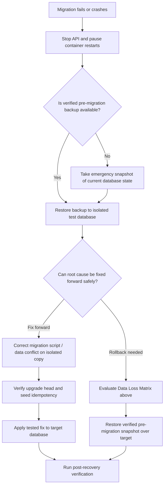

# Database Operations and Migration Recovery Runbook

This runbook provides tested operational instructions for database backups, restores, migration preflight, and failure recovery across PortPilot's supported environments: local SQLite, Docker Compose PostgreSQL, and the Render preview environment.

---

## 1. Environment Profiles and Data Durability

| Environment | Database Engine | Persistence Mechanism | Backup / Recovery Guarantee | Data Durability Status |
|---|---|---|---|---|
| **Local Development** | SQLite (`api/portpilot.db`) | Local filesystem | File copy or SQLite Online Backup API | Single-developer only; zero external durability. |
| **Local / CI Compose** | PostgreSQL 16 (`postgres:16-alpine`) | Named volume `postgres_data` | `pg_dump` and `pg_restore` via Docker Compose | Persistent locally; no automated offsite snapshot. |
| **Render Free Preview** | PostgreSQL 16 (`portpilot-db` in `render.yaml`) | Render free disk (1 GB) | **NO PROVIDER BACKUPS; NO PITR; 30-DAY EXPIRATION** | **DISPOSABLE PREVIEW ONLY.** Storing user or unrecoverable operational data is strictly blocked. |
| **Durable Production Target (Prerequisite)** | Managed PostgreSQL (e.g. Render Team/Paid, AWS RDS, Supabase, Cloud SQL) | Managed persistent disk with redundancy | Automated daily backups, point-in-time recovery (PITR) >= 7 days, cross-AZ/offsite standby | Required before storing persistent user data, published correction history, or user reports. |

> [!CAUTION]
> **Render Free Database Limitation:** The Render Free tier database configured in `render.yaml` automatically expires after 30 days and provides **no** provider snapshots or point-in-time recovery. It is suitable only for disposable preview testing. Do not migrate production or permanent data to Render Free.

---

## 2. Backup and Restore Procedures

### 2.1. Local SQLite (`portpilot.db`)

SQLite databases store all data in a single file, with optional write-ahead log files (`.db-wal` and `.db-shm`).

#### Method A: Cold Offline Backup (API Stopped)
1. Stop the local API service:
   ```powershell
   # If running in terminal, press Ctrl+C or terminate uvicorn
   ```
2. Copy the database file and any active WAL state to a timestamped backup directory:
   ```powershell
   $timestamp = Get-Date -Format "yyyyMMdd_HHmmss"
   Copy-Item -Path "api/portpilot.db" -Destination "api/portpilot_backup_$timestamp.db"
   if (Test-Path "api/portpilot.db-wal") {
       Copy-Item -Path "api/portpilot.db-wal" -Destination "api/portpilot_backup_${timestamp}.db-wal"
   }
   if (Test-Path "api/portpilot.db-shm") {
       Copy-Item -Path "api/portpilot.db-shm" -Destination "api/portpilot_backup_${timestamp}.db-shm"
   }
   ```
3. Verify backup file integrity:
   ```powershell
   python -c "import sqlite3; con = sqlite3.connect('api/portpilot_backup_$timestamp.db'); print(con.execute('PRAGMA integrity_check;').fetchone()); con.close()"
   # Expected output: ('ok',)
   ```

#### Method B: Zero-Downtime Hot Backup (Online Backup API)
Run the online backup script without stopping the API:
```powershell
python -c "
import sqlite3, datetime
ts = datetime.datetime.now().strftime('%Y%m%d_%H%M%S')
src = sqlite3.connect('api/portpilot.db')
dst = sqlite3.connect(f'api/portpilot_backup_{ts}.db')
src.backup(dst)
dst.close()
src.close()
print(f'Backup created: api/portpilot_backup_{ts}.db')
"
```

#### SQLite Restore Procedure
1. Stop the API service.
2. Verify the integrity of the backup file before replacing active state:
   ```powershell
   python -c "import sqlite3; con = sqlite3.connect('api/portpilot_backup_<timestamp>.db'); print(con.execute('PRAGMA integrity_check;').fetchone()); con.close()"
   ```
3. Test restoration to an isolated temporary copy:
   ```powershell
   Copy-Item "api/portpilot_backup_<timestamp>.db" "api/portpilot_test_verify.db"
   python -c "
import sqlite3
con = sqlite3.connect('api/portpilot_test_verify.db')
cur = con.cursor()
cur.execute('SELECT version_num FROM alembic_version;')
print('Revision:', cur.fetchone())
cur.execute('SELECT count(*) FROM laptops;')
print('Laptops:', cur.fetchone())
con.close()
"
   Remove-Item "api/portpilot_test_verify.db"
   ```
4. Replace the active database file:
   ```powershell
   Remove-Item -Path "api/portpilot.db*" -ErrorAction SilentlyContinue
   Copy-Item "api/portpilot_backup_<timestamp>.db" "api/portpilot.db"
   ```
5. Restart the API and verify `GET /ready` and `GET /devices`.

---

### 2.2. Docker Compose PostgreSQL

In Docker Compose, PostgreSQL runs in container service `db` with data stored in volume `postgres_data`.

#### Taking a PostgreSQL Backup (`pg_dump`)
Run a compressed custom-format dump (`-Fc`) against the running `db` service:
```powershell
# From project root:
$timestamp = Get-Date -Format "yyyyMMdd_HHmmss"
docker compose exec -T db pg_dump -U portpilot -d portpilot -Fc > "backups/portpilot_$timestamp.dump"
```
Or for isolated test containers (e.g. `portpilot-e2e-e2e-db-1`):
```powershell
docker exec portpilot-e2e-e2e-db-1 pg_dump -U portpilot_e2e -d portpilot_e2e -Fc -f /tmp/backup.dump
```

#### Verifying Dump Integrity
Verify the dump archive table-of-contents without restoring:
```powershell
docker compose exec -T db pg_restore -l < "backups/portpilot_$timestamp.dump" | Select-Object -First 20
```
Expected output confirms format `CUSTOM`, target db, and list of TOC entries (tables, indexes, constraints).

#### Testing Restore into an Isolated Database (Rehearsal)
Always rehearse restoration against an isolated database before modifying the active database:
```powershell
# 1. Create temporary isolated database
docker compose exec -T db createdb -U portpilot portpilot_isolated_verify

# 2. Restore dump into isolated database
docker compose exec -T db pg_restore -U portpilot -d portpilot_isolated_verify < "backups/portpilot_$timestamp.dump"

# 3. Verify schema revision and row counts
docker compose exec -T db psql -U portpilot -d portpilot_isolated_verify -c "SELECT version_num FROM alembic_version; SELECT count(*) FROM laptops; SELECT count(*) FROM accessories;"

# 4. Drop the temporary database
docker compose exec -T db dropdb -U portpilot portpilot_isolated_verify
```

#### Full Restoration to Active Compose Database
1. Stop the API service to halt incoming writes:
   ```powershell
   docker compose stop api
   ```
2. Drop and recreate the active database, or restore clean:
   ```powershell
   docker compose exec -T db dropdb -U portpilot --if-exists portpilot
   docker compose exec -T db createdb -U portpilot portpilot
   docker compose exec -T db pg_restore -U portpilot -d portpilot < "backups/portpilot_$timestamp.dump"
   ```
3. Restart the API:
   ```powershell
   docker compose start api
   ```
4. Confirm post-recovery checks:
   - `curl -f http://localhost:8001/ready` -> `{"status":"ready"}`
   - `curl -s http://localhost:8001/devices` -> verifies verified devices are present.

---

### 2.3. Hosted Environments (Render)

#### Render Free Preview (`render.yaml`)
- **Limitation:** The free database plan (`plan: free`) has **no automated backups**, **no point-in-time recovery (PITR)**, and **expires after 30 days**.
- **Operational policy:** Treat the database as ephemeral/disposable. Do not store sensitive or unrecoverable user data.
- **Manual export:** Maintainers can take an ad-hoc export via `pg_dump` using Render's external connection string before teardown:
  ```bash
  pg_dump -Fc "$RENDER_DATABASE_EXTERNAL_URL" > render_preview_export.dump
  ```

#### Durable Hosted Plan Requirements (Before Production Release)
Before accepting user reports or publishing persistent data in a hosted deployment:
1. Upgrade to a paid/managed database tier that includes automated daily snapshots and point-in-time recovery (minimum 7-day window).
2. Document the provider console steps:
   - Render Dashboard -> PostgreSQL -> Backups -> Select snapshot -> Restore to new database.
   - Update API `DATABASE_URL` to point to the restored database service.

---

## 3. Migration Operations and Failure Response

### 3.1. Container Startup Migration Behavior
PortPilot's container image (`Dockerfile`) and Render Blueprint (`render.yaml`) run database migrations on container startup:
```sh
alembic upgrade head && python -m app.seed && uvicorn app.main:app ...
```
- If `alembic upgrade head` fails:
  - The process exits with a non-zero exit code.
  - The web server does not start.
  - Container orchestrators (Docker Compose, Kubernetes, Render) will initiate container restart according to restart policy.
  - In a continuous crash loop, **halt deployment retries** immediately to avoid repeated partial schema mutations or database locking.

### 3.2. Migration Preflight Checklist
Before applying any migration to a shared or production database:
1. **Confirm target `DATABASE_URL`:**
   ```powershell
   python -c "import os; from app.database import normalize_database_url; print(normalize_database_url(os.getenv('DATABASE_URL')))"
   ```
   Ensure the host, port, and database name match the intended environment.
2. **Inspect current revision against migration history:**
   ```powershell
   alembic current
   alembic history --verbose
   ```
3. **Execute and verify a pre-migration backup:**
   Follow Section 2.1 (SQLite) or Section 2.2 (PostgreSQL) and verify dump integrity before proceeding.

### 3.3. Failure Response and Partial Migration Triage
If a migration fails or is interrupted:

1. **Pause writes and deployment retries:**
   Stop the API deployment or set container replicas to 0 / pause restarts.
2. **Capture diagnostics:**
   - Save the container/terminal failure traceback.
   - Run `alembic current` to determine the recorded revision in `alembic_version`.
3. **Inspect partial DDL state:**
   - **PostgreSQL:** Transactional DDL ensures that DDL statements inside a transaction roll back atomically on failure. However, multi-statement migrations that commit intermediate transactions or use non-transactional statements (like `CREATE INDEX CONCURRENTLY`) may leave partial artifacts.
   - **SQLite:** DDL is non-transactional. A failed migration may leave newly created tables or columns in place while `alembic_version` remains at the previous revision.
   - Query the information schema or SQLite master:
     ```sql
     -- PostgreSQL
     SELECT table_name FROM information_schema.tables WHERE table_schema='public';
     -- SQLite
     SELECT name FROM sqlite_master WHERE type='table';
     ```
4. **Do NOT run `alembic downgrade` blindly:**
   Downgrades remove tables and columns unconditionally. If the migration failed midway, downgrade scripts may fail with "table already dropped" or "column does not exist", or may inadvertently delete tables created earlier.

### 3.4. Data Loss Matrix for Downgrades

| Alembic Revision | Scope of Change | Consequence of `alembic downgrade` |
|---|---|---|
| `20261103_0006` | Creates `result_reports` table | **Drops table and permanently destroys all user-submitted compatibility reports.** |
| `20261103_0005` | Adds `display_configurations` JSON column | **Drops column; discards all evidence-backed simultaneous display configurations** entered on laptops and accessories. |
| `20261103_0004` | Creates `catalogue_corrections` and `evidence_conflicts` | **Drops tables; permanently destroys all audit/correction history and conflict records.** |
| `20261102_0003` | Adds `hardware_revision` and `region_variant` columns | **Drops columns; removes exact hardware revision and regional distinctions.** |
| `20261102_0002` | Adds `usb_c_video_supported` column | **Drops column; loses known boolean video support distinct from null.** |
| `20261102_0001` | Creates `laptops`, `accessories`, `source_evidence` tables | **Drops entire catalogue and manufacturer evidence history.** |

### 3.5. Safe Recovery Decision Flow


### 3.6. Post-Recovery Verification Checklist
After recovering from a backup or failed migration:
1. Verify database schema revision:
   ```powershell
   alembic current
   ```
2. Verify API readiness:
   ```powershell
   curl -f http://127.0.0.1:8001/ready
   ```
   Must return `200 OK` with `{"status":"ready"}`.
3. Verify public catalogue visibility:
   ```powershell
   curl -s http://127.0.0.1:8001/devices
   ```
   Ensure verified laptops and accessories are returned.
4. Verify deterministic compatibility evaluation:
   ```powershell
   curl -s -X POST http://127.0.0.1:8001/checks -H "Content-Type: application/json" -d '{"laptop_id":"lenovo-ideapad-slim-3-14irh10r","accessory_id":"anker-555-usb-c-hub","setup":{"external_displays":1,"resolution":"1920x1080","refresh_rate_hz":60,"laptop_charging":false}}'
   ```
   Must return `200 OK` with evaluated verdict and capability evidence.
