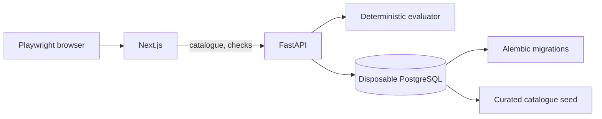

# End-to-end testing plan

## Purpose

Prove that PortPilot works as a user-facing system across the browser, Next.js frontend, FastAPI service, database, migrations, catalogue evidence policy, and shared-result links. Keep the existing focused rule and API tests; add browser automation for journeys that those tests cannot prove.

This is a plan, not an implementation or a claim that end-to-end testing currently runs. The repository currently has backend unit/handler tests and lint/build checks in GitHub Actions, but no browser automation. The current Render configuration is a preview and has not been deployed, so the initial end-to-end target is a disposable local/CI environment.

## System under test

The application’s critical paths are:

- Browse only verified laptops and accessories, with verified evidence.
- Configure a setup and submit a compatibility check; show the verdict, requirement details, limits, and evidence returned by the API.
- Clear an old result when any input changes, and show an actionable failure if the API or catalogue is unavailable.
- Copy and reopen a shared result URL; restore the inputs and rerun the check.
- Render the coverage page from live catalogue data.
- Keep catalogue administration protected and prevent draft or review-needed records from appearing in public endpoints or check evidence.
- Start the production frontend in the same standalone mode configured for Render.

## Test layers and tools

| Layer | Purpose | Tool/target | Gate |
| --- | --- | --- | --- |
| Existing unit and handler tests | Rule boundaries, schemas, admin policy, API behavior | pytest with isolated SQLite fixtures | Every pull request |
| API black-box integration | HTTP routing, validation, serialization, CORS, auth, DB integration | pytest + FastAPI TestClient or HTTP client against disposable PostgreSQL | Every pull request |
| Browser end-to-end | Real user journeys from browser through API and database | Playwright Test with Chromium | Every pull request |
| Browser compatibility | Catch engine-specific layout and behavior issues | Playwright Firefox and WebKit | Nightly or release candidate; promote failures to PR gate when stable |
| Production artifact smoke | Verify built standalone frontend and container/service wiring | Docker Compose production-like profile or built images | Pull request/release candidate |
| Accessibility and responsive checks | Keyboard, labels, focus, error announcements, small viewport | Playwright assertions plus axe-core scan | Pull request for critical checks; full scan on release candidate |
| Performance and resilience | Latency, startup, DB unavailable, API unavailable, bounded request behavior | k6 or Locust plus controlled failure injection | Release candidate; no shared production load |
| Deployment smoke | Confirm public origins, health/readiness, catalogue, and a check | Short, low-rate smoke against an isolated preview deployment | After deploy; never mutate public catalogue |

Use Playwright Test for the browser layer: it supplies browser contexts, assertions, retries/reporters, and Chromium/Firefox/WebKit projects. Configure local servers through its `webServer` support and use an explicit base URL. Pin the package version through `package-lock.json`; update it deliberately with browser binaries in CI. See the [Playwright installation guide](https://playwright.dev/docs/intro), [web server configuration](https://playwright.dev/docs/test-webserver), and [CI guidance](https://playwright.dev/docs/ci).

## Environments and data rules

### Local and CI

- Run a fresh PostgreSQL service/container for each job. Apply Alembic migrations from an empty database, then seed the catalogue using the production seed path.
- Do not point end-to-end tests at a developer’s persistent Compose volume. Give the job its own database/schema and remove it when the job ends.
- Start the API and built frontend with explicit test origins and a throwaway admin token. Never use Render or another shared account secret in CI.
- Prefer a separate, deterministic E2E fixture dataset for assertions that require a known pass, known failure, draft, or needs-review state. Use synthetic manufacturer URLs and avoid changing curated production seed facts just to make a test pass.
- Seed via supported migration/seed flows for the baseline; create temporary test records through the protected API or a test-only fixture for lifecycle/security cases.
- Ensure each test can run independently and repeatedly. Reset its data or use unique IDs; do not depend on execution order.
- Capture Playwright traces/screenshots on failure, but ensure artifacts contain no tokens or real user information.

### Preview and production

- Initially, do not run destructive admin or load scenarios against a shared deployment.
- If an isolated preview is later connected, use synthetic records and a dedicated disposable database. Run only health, catalogue, one compatibility request, frontend load, and share-link smoke checks.
- Never run write tests, load tests, credential probes, or failure injection against production. A public release requires an approved isolated staging target first.

## Browser journey scenarios

Implement these as named, independent user journeys. Assert accessible roles/labels and user-visible outcomes rather than CSS class names or implementation details.

### P0: release-blocking core journeys

1. **Initial load and catalogue**: checker renders; catalogue options populate; no uncaught page errors or failed required requests; a draft and a needs-review record are absent.
2. **Successful check**: select a fixture laptop/accessory, choose display and charging settings, submit, and verify the API-backed verdict, summary, requirements, limit state, and verified evidence links.
3. **Known incompatibility and unknown**: run separate fixtures that deterministically produce `incompatible` and `insufficient_data`; check that neither is mislabeled as compatible and the requirement details explain the result.
4. **Stale-result prevention**: run a check, change laptop, accessory, display count, resolution, refresh rate, and charging in turn; confirm the prior verdict disappears until a new check succeeds.
5. **Share round trip**: submit a check, copy the resulting URL, open it in a fresh browser context, and verify all input values and the rerun result. Also cover clipboard denial/failure and the visible fallback message.
6. **API failure states**: fail catalogue load and compatibility submission separately; confirm clear error messaging, no stale result, no broken page, and recovery after the service returns.
7. **Coverage page**: open `/coverage`, wait for live verified catalogue totals, verify category content, and navigate back to the checker.
8. **Production startup**: build the frontend and confirm the configured standalone server serves `/` and `/coverage`, and can reach the API using the configured public API origin.

### P1: security, policy, and data-integrity journeys

1. Public catalogue and detail endpoints expose only verified devices and verified evidence.
2. Check responses include only verified evidence; a review-needed source must not leak through the check endpoint.
3. Admin endpoints reject missing, incorrect, and malformed bearer tokens; admin routes fail closed when no token is configured.
4. Draft creation is allowed for authorized admins but drafts stay absent from public listing, details, and checks.
5. Publishing rejects missing required fields, missing evidence for populated capabilities, unverified evidence, and invalid capability keys; valid verified records become visible.
6. Updating a record replaces its evidence atomically; verify old evidence is removed and the new record remains correctly associated.
7. Invalid IDs, malformed payloads, unsupported values, and duplicate IDs return stable structured errors without leaking secrets or database details.
8. Logs and metrics use route templates and bounded labels; they do not include request bodies, query strings, credentials, or device IDs.

### P2: usability, resilience, and broader coverage

- Keyboard-only path through device selectors, setup fields, check action, result, evidence links, and navigation; visible focus and logical tab order.
- Accessible names, headings, error announcements, status updates, contrast, and zoom/reflow at narrow mobile width and 200% zoom.
- Test representative desktop and mobile viewports, including no horizontal overflow and usable controls.
- Simulate database unavailable at startup and after startup; verify readiness transitions and generic safe responses.
- Simulate slow API responses and request failure; confirm loading state, duplicate-submit behavior, recovery, and no stale response overwrites a newer selection.
- Test catalogue empty state, one-item state, long model/source names, and unusually long evidence excerpts.
- Basic performance baseline for catalogue load and check submission with a small, documented virtual-user count against isolated data.

## API black-box scenarios

Call the running service over HTTP rather than invoking route functions directly for this layer. Cover:

- `GET /health`, `GET /ready`, `GET /devices`, device details, and `POST /checks` success, not-found, and validation responses.
- `GET /admin/laptops` and `/admin/accessories`, plus create/update lifecycle, with no token, bad token, and valid token.
- CORS preflight and allowed/disallowed origins matching the configured frontend origin.
- Pagination/filtering if introduced; until then, verify stable ordering and counts only where the API promises them.
- PostgreSQL constraints, migration from an empty database, and seed idempotency (running the seed twice produces no duplicate records and does not expose review-needed items).
- Response schemas remain compatible with the TypeScript client types; consider generating a checked OpenAPI snapshot or schema contract once API evolution becomes frequent.

Keep the fast SQLite handler tests for isolated logic. PostgreSQL E2E is required because SQLite does not prove production dialect behavior, migration correctness, constraints, or connection configuration.

## CI and release gates

### Pull request gate

1. Run the current Ruff, pytest, ESLint, Prettier, and production build jobs.
2. Add an isolated PostgreSQL integration job for migration, seed idempotency, and HTTP API critical paths.
3. Add Playwright Chromium P0 journeys against the built frontend and running API/PostgreSQL. Use a fixed browser worker count initially to reduce resource contention and flaky behavior.
4. Publish HTML report and failure traces as short-retention CI artifacts, only on failure or when requested.
5. Require all blocking jobs to pass before merge; quarantine flaky tests only with an issue, owner, and expiry date.

### Nightly/release candidate

- Run Chromium, Firefox, and WebKit P0 journeys.
- Run P1 lifecycle/security cases and axe accessibility scans.
- Run production-like container/standalone smoke, DB restart/readiness checks, and low-rate performance baseline.
- For an isolated preview, run read-only deployment smoke after each deploy and record build SHA, environment, result, and timestamp.

### Release decision

Release only when all P0 tests pass against the exact candidate SHA, no open P0/P1 defects remain, migrations succeed from empty and previous supported schema states, and the deployed candidate passes the safe smoke suite. Record known P2 limitations and test artifacts with the release.

## Test design and reliability standards

- Use page object helpers only for repeated stable interactions; keep scenario intent and assertions visible in each test.
- Use accessible locators (`getByRole`, `getByLabel`, `getByText`) and deterministic test IDs only where semantics cannot identify a stable target.
- Wait for observable state or the relevant network response; avoid fixed sleeps.
- Assert both positive and negative behavior, especially that drafts, unverified evidence, and previous results do not appear.
- Keep test data explicit; do not assert against live catalogue counts or unstable manufacturer pages.
- Do not use external manufacturer links as test dependencies. Verify that evidence URLs are present and well-formed without fetching them.
- Use deterministic service/network interception only for failure states; the primary happy path must use the actual local API and database.
- Make tests idempotent and safe for retries. Retry at the CI runner level only for infrastructure transients; report product flakes instead of masking them.
- Set actionable timeouts from measured startup/runtime, not arbitrary long waits. Track duration and flake rate by spec.
- Never store admin tokens or sensitive environment values in test snapshots, traces, screenshots, or logs.

## Delivery phases

| Phase | Deliverable | Exit criteria |
| --- | --- | --- |
| 0. Baseline | Inventory testable flows, mark current known limitations, choose isolated CI database and artifact retention | Approved P0 scenarios and clean test-data strategy |
| 1. Harness | Add Playwright, browser install, config, local service orchestration, deterministic fixtures, CI report artifacts | One smoke journey runs reliably from a clean checkout locally and in CI |
| 2. Core browser flows | Implement P0 journeys 1–8 | P0 passes repeatedly on Chromium without order dependence |
| 3. Real DB/API | Add PostgreSQL migration/seed/HTTP jobs and P1 policy lifecycle flows | Clean DB setup, idempotent seed, API security/policy verified end to end |
| 4. Usability and resilience | Add keyboard/accessibility, responsive, failure, and restart journeys | Critical accessibility findings fixed; failures recover without stale results |
| 5. Release confidence | Add cross-browser schedule, production-like smoke, low-rate performance baseline | Candidate SHA passes documented release gate; results are reproducible |

## Initial scorecard

Track these values per pull request and release candidate:

- P0 pass rate: **100% required**.
- P0 flake rate: target **under 1%** across the last 30 CI runs; investigate any repeated flaky case.
- Critical API/browser error count: **zero**.
- Verified-evidence policy violations: **zero**.
- P0 scenario coverage: **all scenarios implemented and passing** before a public release.
- Median and p95 duration for the E2E job, plus per-test runtime, to keep PR feedback predictable.
- Open defects by severity, owner, and release disposition.

Performance latency thresholds should be set only after measuring the isolated CI environment and defining a preview service budget. Do not turn an unmeasured local timing into a public service-level objective.

## Ownership and defect handling

- Each failing scenario maps to the owning layer: frontend, API contract, rule engine, database/migration, deployment, or test harness.
- Every P0/P1 failure blocks the gate until fixed or explicitly waived with a named reviewer, reason, mitigation, and expiry.
- A test bug is fixed separately from an application bug; do not weaken an assertion just to restore a green run.
- New user-visible features add acceptance scenarios in the same change, including at least one error/edge path.
- Keep this plan current as routes, supported setups, or release targets change.
